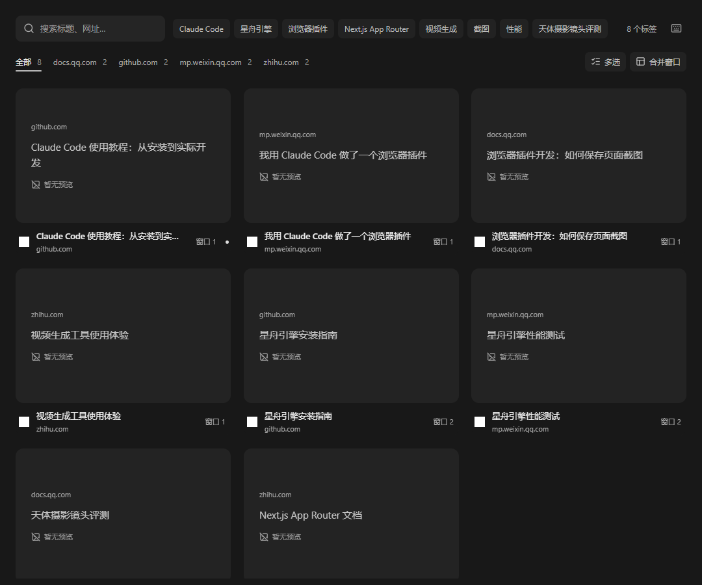

# 照面 Glimpse

<p align="center"></p>

**看一眼，找到熟悉的页面。**

用缩略图快速找到散落在不同窗口里的网页，顺手整理标签。保持炭灰界面、短搜索框和轻量工具栏，无账户、无模型、无云端服务。

A lightweight, local visual tab finder for Chrome. Preview, search, switch, and organize open tabs across windows.

## 当前版本：1.12.0

- **看图找页**：随浏览自动更新预览；鼠标进入即平滑放大，没有缩略图也可通过标题、网站与状态辨认。
- **快速查找**：标题/网址搜索、本地标题快捷词、可搜索的网站和窗口菜单；准确命中优先，支持最近使用排列和紧凑卡片。
- **顺手整理**：多选关闭并撤销、移动到指定或新窗口、检查重复页面、按指定范围合并窗口。
- **控制预览**：暂停更新、排除指定网站、刷新各窗口活动页面，查看与清理本地缓存。
- **克制的反馈**：悬停、激活和键盘聚焦用灰色背景变化，不出现亮色边框。系统减少动态效果偏好仍有效。



上图使用模拟标签。完整变更记录见 [CHANGELOG.md](CHANGELOG.md)，升级实施记录见 [docs/UPGRADE_PLAN.md](docs/UPGRADE_PLAN.md)。

## 使用

点击扩展图标或按 `Ctrl+Shift+.`（Mac：`Command+Shift+.`）打开总览。

- 输入文字搜索；方向键选择，Enter 定位。Esc 依次退出面板/多选、清空搜索、清除筛选，最后关闭总览。
- 点击卡片窗口编号缩小范围；网站、窗口筛选可叠加。搜索词右侧的快捷词由当前标题在本机提取。
- 点击“多选”后勾选卡片，使用“关闭所选”或“移动所选”。“全选结果”包含当前结果中未滚动到的卡片；更改筛选会清空选择。
- “更多选项”内提供“合并窗口”“检查重复页面”和“设置”。合并面板显示明确的来源窗口、目标窗口和数量。
- 快捷键可在更多菜单或 `chrome://extensions/shortcuts` 中修改。

重复页按**完整网址**匹配，保留查询参数和锚点，普通与隐身分别检查。建议优先保留固定、发声、活动或最近使用页面；固定、发声页面默认不勾选为待关闭项。每组至少留一页。同网址也可能含有不同的未提交内容，需在面板检查后执行。

移动页面不会关闭后重开。完整标签组保留组信息；仅选择组内部分页面时，面板会说明这些页面将离开原组。固定状态在移动后重新核验。移动/合并不提供完整回滚；部分失败保留明确结果。

关闭撤销优先恢复准确的 Chrome 会话，能力受浏览器最近关闭记录限制；只能重新打开网址时会说明未恢复历史及未提交内容。撤销记录仅在当前总览短暂保留。

## 缩略图与隐私

Chrome 120+。安装、浏览器启动及浏览事件会唤醒后台，后台允许正常休眠。截图请求合并并串行处理，页面变化最短 3 秒刷新，恢复检查每 5 分钟进行，失败有有界重试和冷却。

只自动采集符合条件的活动页面，不轮流切换后台标签、不唤醒休眠页面。**首次安装后尚未浏览的标签仍需随正常浏览补齐缩略图**。本地文件需允许文件网址访问；浏览器内部页面使用标题卡片。隐身页面不保存预览。

截图保存在本地 IndexedDB：一份 Blob 图像由标签和网址索引引用。同会话不同标签不借用对方截图，重启后可按完整网址显示标注为“上次浏览”的预览。缓存最长 14 天，最多 500 张，按图像大小与估算索引开销控制在约 32 MiB；旧格式分批迁移，失败仍可读取。写入前后短暂的事务空间及数据库自身开销不计入估算值。

设置仅保存在本机。暂停保留已有预览；排除网站会清除对应预览，按精确域名匹配，子域名需单独添加。可清理全部缓存或单个网站，之后按正常浏览重建。隐私说明见 [PRIVACY.md](PRIVACY.md)。

## 安装与更新

发布包解压后，在 `chrome://extensions/` 开启开发者模式，选择“加载已解压的扩展程序”，选中包含 `manifest.json` 的目录。

从源码安装，需要 Node.js 20.19+（已验证 Node.js 24）及 npm：

```sh
git clone https://github.com/smartai-Labs/Glimpse.git
cd Glimpse
npm ci
npm run build
```

在扩展管理页加载项目的 `dist` 目录。已有用户保持原安装目录，重新构建后点击扩展的“重新加载”，关闭旧总览再打开。原项目目录 `mosaic` 和兼容缓存键无需改名。

## 开发与验证

React 19、TypeScript、Vite 6、Fuse.js、react-window、IndexedDB；卡片动画使用 CSS。测试依赖已包含在项目内，统一使用 `package-lock.json`。

```sh
npx playwright install chromium
npm run check
```

`check` 依次运行构建、静态检查、七组逻辑测试、界面回归和真实扩展冒烟测试。界面测试默认使用已安装的 Chrome；没有系统 Chrome 时设置环境变量 `GLIMPSE_BROWSER_CHANNEL=chromium`。真实扩展测试默认使用 Playwright Chromium，可通过 `GLIMPSE_CHROMIUM_PATH` 指定测试二进制文件。

- `npm test`：后台时钟/队列、搜索、位置、关键词、关闭/撤销及整理引擎。
- `npm run test:browser`：生产界面配模拟 Chrome 标签接口、真实 IndexedDB；覆盖窄屏、键盘/输入法、悬停、设置、迁移失败回退和缓存隔离。
- `npm run test:extension`：在全新的临时浏览器资料目录中加载实际扩展，验证自动截图、设置、缓存、固定/分组移动、重复页关闭及原生撤销。

测试不会连接或操作日常浏览器。实际多屏遮挡、长期负载和人的找页耗时仍受使用环境影响；索引测试耗时不代表整页搜索或首屏指标。

## 打包

Windows：

```sh
npm run package
```

默认先完成全部检查，再生成 `glimpse-<版本>.zip` 并校验根目录清单及版本。已通过检查的同一构建可运行 `./scripts/package.ps1 -SkipChecks`。Linux/macOS 可运行 `bash build_and_pack.sh`。

持续集成在 Windows/Linux 执行完整检查，并由 Windows 生成安装包；源码中不提交 `dist`、浏览器资料目录和 ZIP 文件。

## 项目来源与反馈

基于 [Mosaic](https://github.com/samirpatil2000/mosaic) 修改，保留对原项目及作者的致谢。反馈请使用 [Glimpse Issues](https://github.com/smartai-Labs/Glimpse/issues)。采用 [MIT License](LICENSE)。
